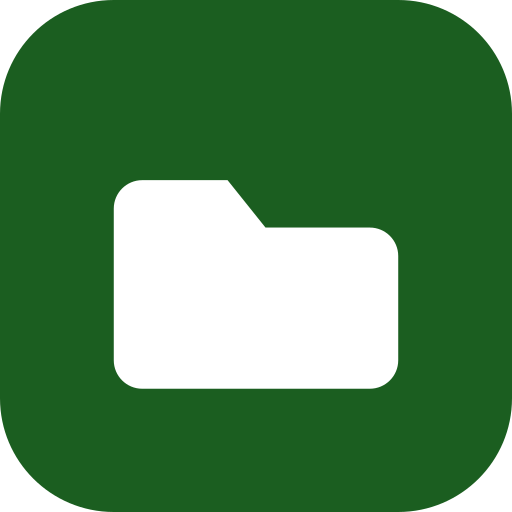

<div align="center">



# FossFiles

**A native Android file manager with no telemetry, no Google services and no bloat.**

[](https://github.com/Abemilek/fossfiles/actions/workflows/build.yml)
[](LICENSE)
[](#)
[](#)
[](#)
[](#)
[](#)

</div>

FossFiles is a native Android file manager written in **a single language: Kotlin** (logic + UI with
Jetpack Compose). The goal: something like Google Files — complete, but **without telemetry, without
Google services (GMS), light and fast**.

## Project policies

### 1. Zero Internet, zero telemetry (a verifiable guarantee, not a promise)
- `AndroidManifest.xml` **does not declare `android.permission.INTERNET`**. Without that permission,
  Android blocks any network connection at the OS level, so the app could not send data to any server
  even if the code tried to.
- Zero third-party SDKs: no Firebase, Crashlytics, Analytics, Ads or Google Play Services.
  Only AndroidX, Compose and kotlinx-coroutines. Thumbnails, the image viewer, ZIP, the trash bin and
  sharing use only system APIs (`ThumbnailUtils`, `BitmapFactory`, `java.util.zip`, `FileProvider`).
  JUnit is test-only and never ships in the APK.
- Your settings, favorites and trash bin are stored on the device only.
- Verify it on any built APK: `aapt2 dump permissions app-release.apk` must not list `INTERNET`.

### 2. Zero animations (so it feels — and is — fast)
- The app animates nothing on its own: no screen transitions, no touch ripple, no sliding sheets or
  menus, no indeterminate progress bars (which animate forever and drain battery).
- Dialogs are just another layer of the screen (not system windows), so they appear instantly.
- The image viewer switches photos and zooms without animating; it is driven by buttons and direct gestures.
- Notices and errors show up in a fixed strip at the bottom (tap to dismiss), not in a Toast.
- Limitations that belong to the system and cannot be removed from the app: the Android 12+ splash
  screen, Android's own keyboard/gesture animations and the "Share" chooser.

### 3. Light APK
- A single universal APK (no per-CPU split: the only native piece is a small AndroidX library,
  `libandroidx.graphics.path.so`, so one APK for every architecture is simpler and barely bigger),
  R8 with minification and resource shrinking, only the `es`/`en` strings from the libraries, no
  leftover metadata and no unused dependencies. Thumbnails and the viewer pull in no image library —
  they use the system one, with a bounded in-memory cache (1/16 of the heap).

## Features
- **Home:** storage used, **quick access** (Downloads, DCIM, Pictures, Documents, Music, Movies — only
  the ones that exist), categories (Photos, Videos, Audio, Downloads, Documents, **Favorites**),
  **Trash** and a **Recents** list.
- **Browse:** go up a level, search by name (6 levels, cancellable), sort by name/date/size/type,
  **list or grid with thumbnails** (photos, videos and **album art** for audio), show/hide hidden
  files. Sort, view and hidden-file choice are remembered.
- **Built-in image viewer:** tap a photo to open it in the app, with zoom (pinch or double tap),
  previous/next buttons and "open with another app". It honors the EXIF orientation of camera photos.
- **Favorites:** mark them from the "⋮" menu in a selection (they show a star and appear in the
  Favorites category; favorite folders open straight in the browser).
- **Local trash bin:** deleting asks whether to move to trash or delete permanently. The trash keeps
  everything for **30 days** (then it empties itself), lets you **restore** to the original folder
  (recreating it if it no longer exists) and empty it. Sending to trash is instant (it copies nothing).
- **Multi-selection** (long-press): copy, cut, delete and, in "⋮": select all, favorites, rename,
  **share**, **compress to ZIP**, **extract ZIP** and **details**.
- Create a folder and paste. Copy never overwrites: if the name exists, it creates `name (1)`.
  Move is an instant rename on the same volume.
- Back button: closes the viewer/selection, goes up a folder, or returns home.

## Requirements
- JDK 17 or newer (the project targets Java 17 and builds fine on JDK 21)
- Android SDK with `platforms;android-34` and `build-tools;34.0.0`
- A device or emulator running Android 8.0 (API 26) or newer

## Build with Android Studio
1. Open the `fossfiles/` folder in Android Studio (Hedgehog or newer).
2. Let Gradle sync (it downloads Kotlin/Compose/AndroidX — these do need internet **once**, on your
   development machine, to build the app; the resulting APK does not).
3. Connect a device or use an emulator with Android 8.0 (API 26) or newer.
4. Run ▶.
5. The first time, the app asks for the "All files access" permission — it takes you straight to Settings to enable it.

## Build with Podman or Docker (no local toolchain)
Don't want to install a JDK, the Android SDK, Gradle or Kotlin? You only need **Podman** (or Docker):

```bash
./build-in-container.sh                    # release APK (default)
./build-in-container.sh assembleDebug      # any Gradle task
./build-in-container.sh testDebugUnitTest  # run the JVM tests
ENGINE=docker ./build-in-container.sh      # use Docker instead of Podman
```

The first run builds a small builder image (`Containerfile`: JDK 17 + the Android SDK, with the
toolchain's telemetry off) and caches Gradle in `.container/gradle`, so later builds are fast. The
generated files belong to you, and your own `local.properties` is left untouched. This is the same
approach CI systems use, and it makes builds reproducible across machines.

## Build from the command line
```bash
# Debug APK -> app/build/outputs/apk/debug/app-debug.apk
./gradlew assembleDebug

# Release APK (signed with the debug key unless you set up a keystore, see below)
./gradlew assembleRelease
```

Install on a physical device (enable USB debugging first):
```bash
adb devices
./gradlew installDebug
# or, with an APK already built:
adb install -r app/build/outputs/apk/debug/app-debug.apk
```

## Signing the APK with your own key
With no configuration the release build is signed with the debug key (fine for testing). To sign it
with your own key (needed to publish and to have updates install on top):

```bash
keytool -genkeypair -v -keystore fossfiles-release.jks -alias fossfiles -keyalg RSA -keysize 2048 -validity 10000
cp keystore.properties.example keystore.properties     # then edit it with your passwords
./gradlew assembleRelease
```

Put the `.jks` in the project root. `keystore.properties` and the `.jks` files are already in
`.gitignore`: **keep a copy of your keystore** — if you lose it you won't be able to update the app
signed with it.

> There is a **single universal APK**: the only native library is a small AndroidX support file
> (`libandroidx.graphics.path.so`), so one APK that covers every architecture is simpler than
> per-CPU builds. Only the strings for Spanish + English are packaged, which keeps the APK small.

## Testing
The file logic (`FileRepository`) and the trash bin (`TrashBin`) do not depend on Android and have
JVM tests:

```bash
./gradlew testDebugUnitTest
```

They cover: invalid names, copy-without-overwrite, moving to the same folder, a folder inside itself,
deleting without following symlinks, search (depth, cancellation, cycles), hidden files, measuring
folder contents, ZIP (round-trip, duplicate names, rejecting paths that try to escape) and the trash
bin (restore to origin, recreating the folder, name conflicts, purging by age, symlinks).

## Behavior notes
- Symlinks are never followed: copy/move/ZIP skip them; deleting removes only the link (they don't go
  through the trash bin).
- The trash bin lives in `.fossfiles-trash/` in internal storage (hidden and with `.nomedia`, so it
  doesn't show up in the gallery) and takes up space until you empty it. Items whose original folder
  no longer exists are restored by recreating it; if that fails, to the root.
- Search shows at most 5,000 results and warns you when there are more.
- Cut and paste across volumes (e.g. to an SD card) copies and then deletes; if the original could not
  be deleted, the app tells you.
- Folders cannot be shared directly: compress them to a ZIP first.
- ZIP extraction creates a new folder next to the archive, rejects unsafe paths and stops if there is
  no free space.
- The viewer does not open SVG (open those with another app).

## Possible next steps
- Audio/video playback in the app, search by type/date/size, range selection
- Search inside file contents (text documents)
- Browsing inside a ZIP without extracting it

## License

FossFiles is free software under the **GNU General Public License v3.0** (or any later version).
You can use, study, modify and redistribute this program, as long as derivative works stay free under
the same license.

See the [LICENSE](LICENSE) file for the full text.

```
Copyright (C) 2026 Abemilek

This program is free software: you can redistribute it and/or modify it under
the terms of the GNU General Public License as published by the Free Software
Foundation, either version 3 of the License, or (at your option) any later version.

This program is distributed in the hope that it will be useful, but WITHOUT ANY
WARRANTY; without even the implied warranty of MERCHANTABILITY or FITNESS FOR A
PARTICULAR PURPOSE. See the GNU General Public License for more details.
```
